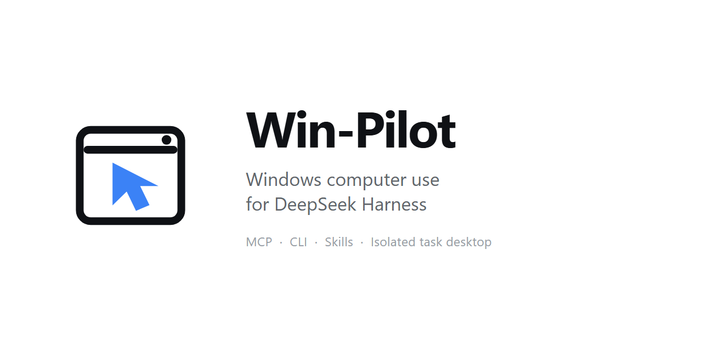

<p align="center">
  
</p>

# win-pilot

[English](./README.md) | 中文

  

Win-Pilot 提供 Windows 电脑操控，优先适配 DeepSeek Harness。`computer` 工具可操作当前桌面，或由用户在设置中开启独立任务桌面，通过紧凑窗口查看、暂停和接管。插件、MCP、CLI 与原生接入共用同一运行时。

## 功能

| 功能 | 具体行为 |
|---|---|
| Agent Plugin 包 | `.codex-plugin/plugin.json` 同时携带 MCP Server 与操作 Skill |
| Windows 原生操控 | UI Automation、Win32 输入/窗口管理和按窗口截图 |
| 后台优先 | 受支持的截图与输入路径尽量避免抢占焦点 |
| 隔离浏览器控制 | 启动 Edge 会话并使用与 CDP 页面绑定的目标和令牌 |
| 可恢复协议 | 统一 `ok`、`outcome`、`error_code`、动作后观察与未知结果处理 |
| 通用后备入口 | 支持工具的 Agent 使用 stdio MCP；仅支持 shell 的 Agent 使用 JSON CLI + Skill |
| Schema 可移植性 | 工具 Schema 持续验证 OpenAI 与 Gemini 系列消费者 |
| DSH Provider 生命周期 | 配置表单要求 DSH 0.2.0-rc.2+；占用唯一的 `computerUse` Provider 槽位 |
| 可选独立任务桌面 | Windows 子会话，默认432×300无标题栏小窗，展开后自动接管与空闲交还 |

## 环境要求

- Windows 10/11 x64
- Node.js 22.12 或更高版本
- Windows PowerShell 5.1
- 可选 .NET 8 Runtime，用于 WGC 截图
- 独立任务桌面需要 .NET 8 Windows Desktop Runtime
- 支持 Agent Plugin、stdio MCP 或 shell 的 Agent

## 快速开始

### 让 Agent 安装（推荐）

把下面这句话发送给 Windows 机器上的 Agent：

```text
请按照 https://raw.githubusercontent.com/JeremyWangCY/win-pilot/main/AGENT_INSTALL.md 安装并验证 Win-Pilot。
```

Agent 会优先安装完整插件；只有宿主不支持插件时，才回退到 MCP 或 CLI。

### 手动安装

支持插件的宿主可以安装 `JeremyWangCY/win-pilot`。插件包已经包含 `.mcp.json` 和 `skills/win-pilot`。

其他宿主使用：

```powershell
npm install -g win-pilot@latest
win-pilot doctor --probe
```

再通过宿主的插件/工具设置注册本地 MCP Server：

```json
{
  "mcpServers": {
    "win-pilot": { "command": "win-pilot", "args": ["mcp"] }
  }
}
```

已知宿主提供便捷安装器，其他 Agent 仍可使用通用模式：

```powershell
win-pilot install --agent codex
win-pilot install --agent claude
win-pilot install --agent qoder
win-pilot install --agent pi
win-pilot install --agent dsh
win-pilot install --agent mcp
win-pilot install --agent cli
```

验证：

```powershell
win-pilot --version
win-pilot status --json
win-pilot doctor --probe --json
```

本版预期版本为 `0.3.0`、平台为 `win32`，doctor 的必要检查全部为 `ok`。doctor 检查安装条件；独立任务会话是否可用仍需实际连接验证。

### 更新

先结束正在进行的界面任务，再更新 runtime，并重启或重新加载宿主的插件/MCP 进程：

```powershell
npm install -g win-pilot@latest
win-pilot doctor --probe
```

DSH profile 需要单独重启。需要刷新 Win-Pilot 管理的 Skill 副本时重新运行 `win-pilot install`；用户自行维护的自定义 Skill 不会在后台更新。

### 沙箱 Agent

如果沙箱会在每条命令结束后回收子进程，应由宿主的常驻插件或 MCP supervisor 启动 `win-pilot mcp`，不要从一次性命令中强行脱离进程。仅支持 shell 的 Agent 可以调用一次性的 `win-pilot request`。

## 使用方法

0.3.0 新增会话级 `stop` / `resume`、正在执行及排队请求的取消，以及每用户的原子控制锁。停止后仍可观察。桌面元素使用稳定的稀疏编号，无障碍树输出 `full` / `delta` / `no_change`；隐藏观察不推进模型可见基线。富文本 `paste` 支持 `format: text | html | md`，恢复受支持的原剪贴板格式，并保留用户并发复制的新内容。Markdown 仅支持部分语法。

浏览器新增 `browser_frames`、`browser_filechooser`、`browser_claim_tab` 和 `browser_finalize`。同源子框架使用 `frame_id` 及语义引用；跨域框架和 OOPIF 明确拒绝。标签认领绑定当前控制会话，修改时传回 `claim_id`，完成后交付释放控制，不主动切换标签。先开启文件选择器监听，再打开选择器、读取事件，随后在 60 秒内将单次 `filechooser_id` 及明确的绝对文件路径传给 `browser_upload`。当前仍使用显式本机 CDP 连接，尚未提供用户浏览器扩展。

原生取消在系统调用之间检查；阻塞的系统/UIA 调用可能需要限时结束子进程，并返回结果不确定，此时应先观察。剪贴板恢复无法提供操作系统级的原子比较交换保证。

插件和 MCP 宿主会获得 `computer` 工具。仅支持 shell 的宿主使用相同的 JSON 接口：

```powershell
win-pilot request --payload '{"action":"list_apps"}' --json
win-pilot request --payload '{"action":"get_window_state","hwnd":12345,"include_text":true}' --json
win-pilot request --payload '{"action":"click","hwnd":12345,"element_index":7,"snapshot_id":"<snapshot>"}' --json
```

| 类别 | 动作 | 主要输入 |
|---|---|---|
| 发现 | `list_apps`、`list_windows`、`get_app_identity` | `app`、`hwnd` |
| 观察 | `get_window_state`、`get_window`、`screenshot` | `include_text`、`include_screenshot` |
| 指针 | `click`、`double_click`、`mouse_move`、`drag`、`scroll` | `x`、`y`、`element_index`、`snapshot_id` |
| 键盘 | `type_text`、`press_key`、`hold_key`、`set_value` | `text`、`key`、`keys`、`duration_ms` |
| 窗口 | `launch_app`、`activate_window`、`minimize_window`、`close_window` | `name`、`hwnd`、`foreground` |
| 浏览器 | `browser_state`、`browser_observe`、`browser_open`、`browser_click`、`browser_click_text`、`browser_click_point`、`browser_type`、`browser_replace`、`browser_key`、`browser_upload` | `browser`、`tab_id`、`browser_element`、`screenshot_id`、`url` |
| 顺序执行 | `wait`、批量 `actions` | `seconds`、`when`、`expect` |

MCP `tools/list` 返回的实时 Schema 是完整参数和默认值的权威定义。

## 设置

在 DeepSeek Harness **0.2.0-rc.2 或更新版本**中，打开「设置 → Win-Pilot」或插件详情页。当前宿主直接投射插件的 `Config`。显示偏好实时生效；电脑操作环境只影响新任务。

| 偏好 | 默认值 | 作用 |
|---|---|---|
| `overlay` | `true` | 显示操作光标 |
| `statusPill` | `true` | 显示运行状态提示 |
| `browserHeadlessDefault` | `false` | 浏览器在后台运行，不显示窗口 |
| `desktopEnvironment` | `current` | 电脑动作的执行位置：当前桌面或独立任务窗口 |

`desktopEnvironment` 默认 `current`（当前桌面），可选 `task`（独立任务窗口）。保存后对新任务生效；已有任务保持原桌面，避免已观察的目标悄然改变。关闭时，模型工具定义、运行时技能和诊断不宣传独立桌面选项。开启后，电脑动作、观察、剪贴板和恢复都使用同一任务桌面；连接失败不会转到主桌面。浏览器动作只能使用同一任务启动的浏览器。

小窗采用浅色、无原生标题栏的样式，默认432×300，只留放大收回、置顶和关闭。放大后直接点击、拖动或输入即可接管；AI 停止输入确认后才交付第一个手势。空闲10秒后交还 AI，按住鼠标或按键期间不会自动交还。缩小后为只读预览；右键工具栏可打开本机登录设置。首次完成 Windows 功能准备与本机登录，可选择通过当前用户 DPAPI 和凭据管理器记住登录，密码只在本机窗口输入。需要 .NET 8 Windows Desktop Runtime 及可用的 Windows 子会话功能；更换 Windows 用户、密码或系统策略后可能需要重新设置。

更新已加载的插件后，先重启 DeepSeek Harness 再保存新增选项。行为和验证限制见[独立任务桌面](./docs/task-desktop.md)。

查看原生窗口：`win-pilot desktop --preview`。预览不能连接会话或执行电脑动作。正常连接入口为 `win-pilot desktop`，受启动拦截约束。源码构建使用 `npm run build:desktop`，无会话测试使用 `npm run test:desktop`。

数值限制和输入策略采用内部默认值，旧设置不再改变它们；必需的 Windows/Meta 系统按键能力始终开启。后台输入、锁屏检查、用户输入中断、焦点让路和窗口文字读取遵循本项目自己的[桌面控制契约](docs/desktop-control-contract.md)。没有宿主的 CLI/MCP 安装使用内置默认值。

## 工作原理

```text
Windows Agent
  ├─ Agent Plugin ─┐
  ├─ stdio MCP ────┼─> Win-Pilot runtime ─> PowerShell helper ─> UIA / Win32 / WGC
  ├─ CLI + Skill ──┤          └────────────> CDP provider ─────> 隔离 Edge
  └─ 原生 Adapter ─┘
```

Runtime 是深模块，负责动作语义和返回结果。Adapter 只注册和渲染接口，因此一次修复可以覆盖所有宿主。

## 安全与隐私

Win-Pilot 以当前 Windows 用户权限运行，不包含遥测，也不会上传截图。浏览器导航会按任务要求产生正常网络请求。安装插件不会绕过宿主审批、沙箱规则或任务授权。

## 故障排查

| 现象 | 常见原因 | 处理方法 |
|---|---|---|
| 找不到 `computer` | 会话启动后才安装插件/MCP | 重启 Agent 或重新加载 MCP Server |
| MCP 立即退出 | 从一次性沙箱命令启动 | 改由常驻宿主 supervisor 管理 |
| `browser_endpoint required` | 没有自有浏览器会话 | 先以 `headless: true` 启动 Edge |
| 令牌过期 | 目标状态变化或令牌到期 | 重新观察同一目标 |
| doctor 失败 | runtime 条件缺失 | 查看 `win-pilot doctor --probe --json` |
| `computer use provider ... already registered` | DSH 已启用另一个 Computer Use Provider | 只保留一个桌面 Provider |

当前兼容构建的诊断文件仍位于 `%TEMP%\win-pilot-diag.log`。

## 开发

```powershell
git clone https://github.com/JeremyWangCY/win-pilot.git
cd win-pilot
npm run build:wgc
npm run build:desktop
npm run test:desktop
npm test
npm pack --dry-run
```

测试覆盖 CLI 公开协议、MCP 发现/调用、插件清单、安装计划，以及自有 Windows/浏览器 fixture。

## 许可证

[MIT](./LICENSE)
